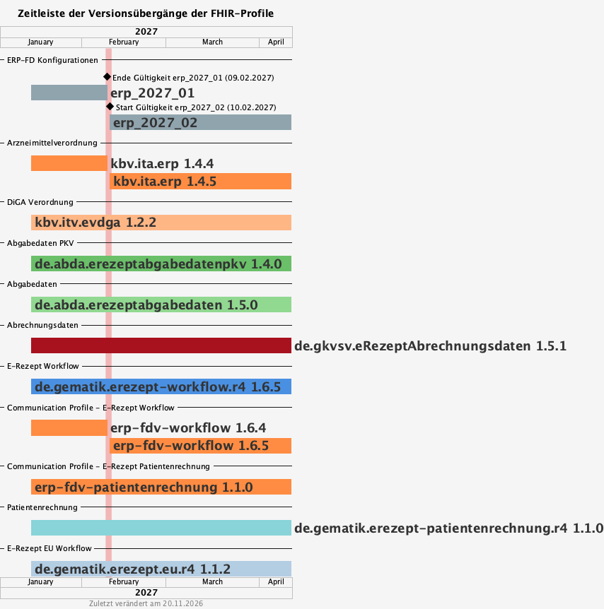

= E-Rezept FHIR Veränderungen für Q1 2027 image:gematik_logo.png[width=150, float="right"]
include::./config-source.adoc[]

toc::[]

Anfang 2027 erfolgt ein Korrekturrelease, der die Angabe von Werten in strukturierten Dosierinformationen betrifft:

* `doseQuantity.value` darf keinen negativen Wert haben
* `boundsDuration.value` muss größer als 0 sein

Siehe hierzu link:https://ig.fhir.de/igs/medication/1.0.8/release-notes.html[ReleaseNotes de.fhir.medication 1.0.8]

== Versionsübergabegänge

Der anstehende FHIR-Profilübergang stellt sich wie folgt dar:

Die zugrundeliegende Konfiguration findet sich hier: link:../resources/configuration/2027-01-01_fhir-transition.json[Konfiguration für den Übergang zu Q1 2027]

=== Package Gültigkeiten

Die Gültigkeiten von FHIR Packages in diesem Übergang stellen sich wie folgt dar:

include::../resources/scripts/output_adoc/2027-01-01_fhir-transition/transition-overview.adoc[]

Hinweis: Die Daten für "in PU einstellbar bis" sind in xref:../docs/erp_deprecated_package_fd.adoc[E-Rezept FHIR-Package Nachhaltung] beschrieben.

Die Profile für die Angaben _erp-fdv-workflow_ und _erp-fdv-patientenrechnung_ entsprechen den Communication Profilen aus den Packages:
[options="header"]
|===
| Profilname | aus Package | Bestandteil von
| GEM_ERP_PR_Communication_Representative | de.gematik.erezept-workflow.r4 | erp-fdv-workflow
| GEM_ERP_PR_Communication_DispReq | de.gematik.erezept-workflow.r4 | erp-fdv-workflow
| GEM_ERPCHRG_PR_PAR_Patch_ChargeItem_Input | de.gematik.erezept-patientenrechnung.r4 | erp-fdv-patientenrechnung
| GEM_ERPCHRG_PR_Communication_ChargChangeReq | de.gematik.erezept-patientenrechnung.r4 | erp-fdv-patientenrechnung
| GEM_ERPCHRG_PR_Consent | de.gematik.erezept-patientenrechnung.r4 | erp-fdv-patientenrechnung
|===

== Änderungen

=== Übersicht
[cols="a,a,a,a"]
[%autowidth]
|===
h|Betrifft h|Feature h|Ressource h|Änderungen

| image:{PVS}[] image:{AVS}[] | *Dosierung* | MedicationRequest, MedicationDispense | 
* `doseQuantity.value` darf keinen negativen Wert haben
* `boundsDuration.value` muss größer als 0 sein

|===

=== Release Notes der FHIR Packages
Weiterhin sind die Releasenotes der FHIR-Packages zu beachten, da diese Änderungsinformationen der Strukturen enthalten:

[cols="a,a,a"]
[%autowidth]
|===
h| Herausgeber h|FHIR Package h| Beispiele
| gematik |  link:https://gematik.de/fhir/de.gematik.erezept-workflow.r4/1.6.5[de.gematik.erezept-workflow.r4 Package 1.6.5^]  | link:https://github.com/gematik/eRezept-Examples/tree/2026-07-01/Standalone-Examples/de.gematik.erezept-workflow.r4[Beispiele de.gematik.erezept-workflow.r4 1.6.5^]
| KBV |  link:https://simplifier.net/packages/kbv.ita.erp/1.4.5[kbv.ita.erp Package 1.4.5^] | link:https://github.com/gematik/eRezept-Examples/tree/2026-07-01/Standalone-Examples/kbv.ita.erp[Beispiele kbv.ita.erp 1.4.3]
|===

